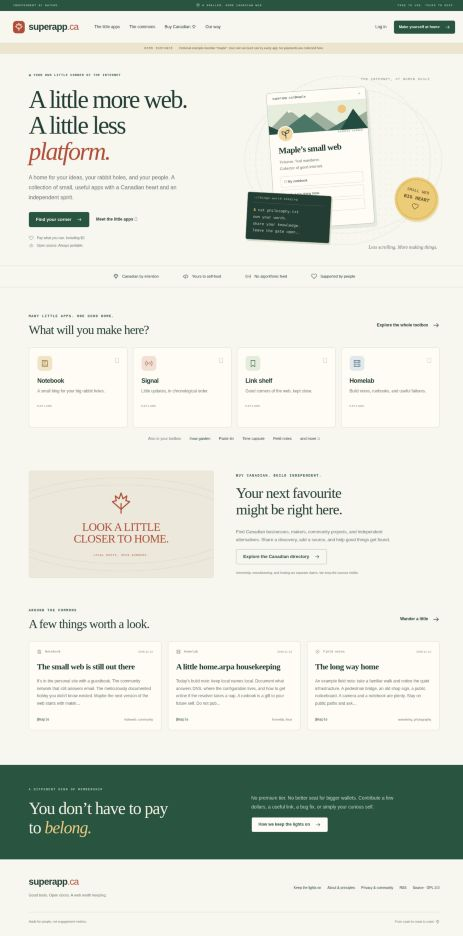

# Superapp.ca

**A little more web. A little less platform.**

A Canadian indie-web commons: many small apps, one account, no paid feature tiers. A personal home for Linux tinkerers, self-hosters, archivists, wandering photographers, and people who miss the human web. Pay what you can, including $0. Everyone is welcome, wherever they live.

Original PHP application and design, inspired by the small-service bundle of [omg.lol](https://omg.lol), not affiliated with it. Source is **GPL-3.0-or-later**. You can run the whole thing on a normal LAMP host. No Composer packages, Node build, tracking scripts, external fonts, CDN, or proprietary backend required.



## What works in this release

| Tool | Implemented behaviour |
| --- | --- |
| Your corner | Public profile, `/now`, `/uses`, 3 themes, discovery opt-out, `rel=me` website link |
| Signal | Status posts, 1,000-byte limit, chronological commons |
| Notebook | Plain-text blog posts with stable URLs, tags, search and RSS |
| Link shelf | Annotated bookmarks, search, public/private visibility, Netscape HTML export |
| Paste tin | Escaped plain-text/code snippets, copy button |
| Short links | Named `/s/handle/slug` links with an explicit destination confirmation page |
| Homelab | Private-by-default runbooks and build notes; optionally publish them |
| Time capsule | A catalogue of archive links and preservation notes (no automatic capture) |
| Field notes | Text notes about trails, local exploring, photography and maker projects |
| /now garden | Discover listed members’ current projects and interests |
| Guestbook | Signed-in messages, owner approval before public display |
| Canadian directory | Source-backed submissions, connection types, search and admin review |
| Portability | JSON account export, atomic entry import, bookmark export, RSS, bearer-token CRUD API |
| Administration | CLI account provisioning/reset, directory review, reports, account suspension |
| Support | Pay-what-you-can explanation plus an optional hosted contribution link; no payment data stored |

Every entry supports **private**, **unlisted**, or **public** visibility. New entries start private. Profiles, `/now`, and `/uses` are public by address; discovery opt-out does not make them private. No likes, follower counts, paid rankings or algorithmic feed.

## Quick local trial

Requires **PHP 8.3+** with PDO and `pdo_sqlite`. From this directory:

```bash
export SUPERAPP_DSN="sqlite:$(pwd)/var/local.sqlite"
export SUPERAPP_DB_USER=''
export SUPERAPP_DB_PASS=''
export SUPERAPP_APP_URL='http://127.0.0.1:8080'
export SUPERAPP_SESSION_SECURE=false
export SUPERAPP_REGISTRATION_OPEN=true
export SUPERAPP_DEMO=true
php bin/console.php migrate
php bin/console.php seed-demo
php -S 127.0.0.1:8080 -t public public/router.php
```

Open `http://127.0.0.1:8080`. Create your own account to exercise the tools. The example `maple` account is read-only and has no published password. The two optional demo directory listings point to primary sources checked on 2026-11-12; they are leads, not endorsements or certifications. Demo seeding is explicit and is not part of production setup.

The PHP development server is for local testing only. Prefer MariaDB and Apache for hosting. **GitHub Pages cannot execute PHP**; the repository stores source, while your LAMP server runs the service.

## LAMP deployment

Read [the deployment guide](docs/DEPLOYMENT.md) for native Apache/PHP or Docker Compose with MariaDB, backups, TLS, domain setup and operating tasks. Start with registration closed, create an admin, configure your contact and hosting disclosures, then open a pilot when ready.

```bash
cp config/config.example.php config/local.php
# Edit the database credentials, URL and operator details in config/local.php.
php bin/console.php migrate
php bin/console.php create-admin YOUR_HANDLE your-email@example.ca
```

Passwords are entered through stdin without echo on a Unix terminal. Never put a real password in a shell command or commit `config/local.php`, `.env`, or `var/`.

## Development and tests

```bash
php tests/domain.php
python3 tests/http_smoke.py http://127.0.0.1:8080
```

The domain suite uses isolated in-memory SQLite unless `SUPERAPP_TEST_DSN` is set. For disposable MariaDB, set `SUPERAPP_TEST_DSN`, `SUPERAPP_TEST_DB_USER`, and `SUPERAPP_TEST_DB_PASS`. Never point tests at production. The HTTP suite needs a disposable running instance with registration enabled; it creates two unique accounts and deletes them after a successful run.

See [validation notes](docs/VALIDATION.md), [API documentation](docs/API.md), [security and operating boundaries](SECURITY.md), and [the roadmap](docs/ROADMAP.md).

## How it is put together

```text
app/         configuration bootstrap, PDO queries, domain rules, views, optional demo seed
public/      only web-served directory: front controller, CSS, JS and favicon
database/    initial schema, used by an idempotent migration command
bin/         account and maintenance CLI
config/      example settings; local.php is ignored
deploy/      Apache and PHP configuration examples
var/         private runtime data and sessions; ignored
tests/       domain and HTTP integration checks
```

The data model is deliberately compact: users, typed entries, directory submissions, guestbook messages, API tokens, reports and temporary rate-limit buckets. Shared entry rules keep ownership and privacy consistent across the eight writing tools. All content is plain text; arbitrary HTML, user CSS, uploads, URL fetching and server-side script execution are not accepted.

This is a functional first release for a small pilot, not a claim of unlimited capacity or a completed public service. Details that remain outside v1 are explicit in the roadmap. Donations do not unlock features. Keep source available when redistributing under the GPL, credit contributors, and build something useful.
