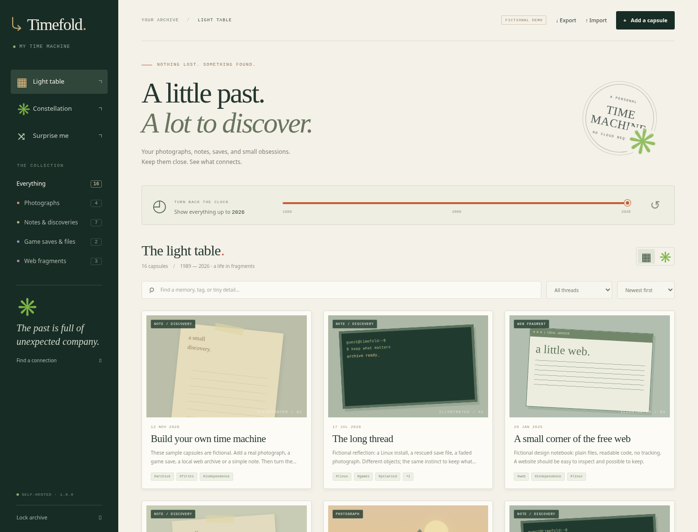
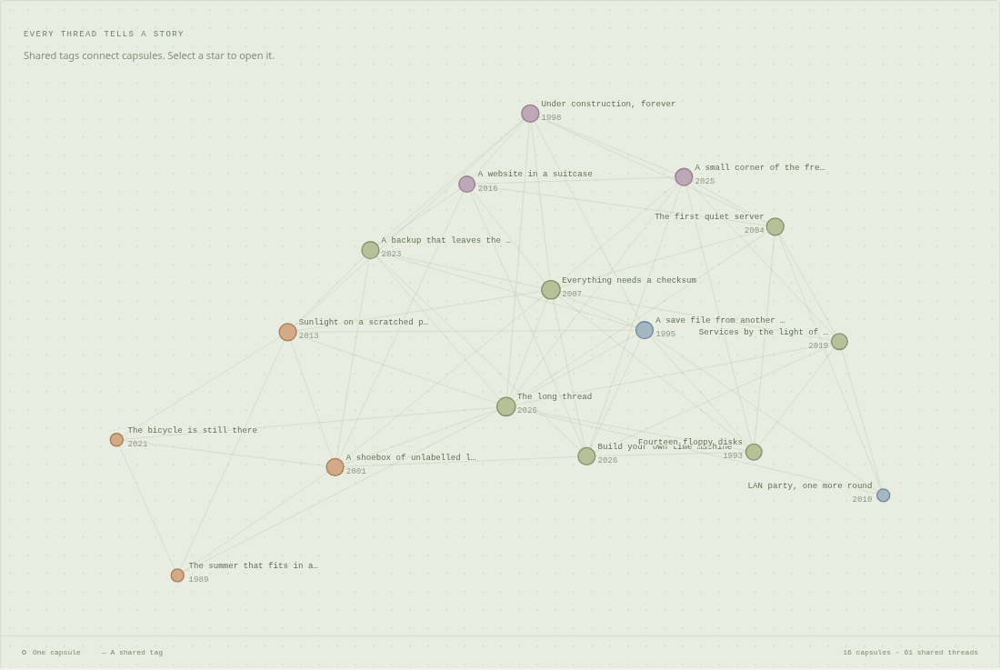
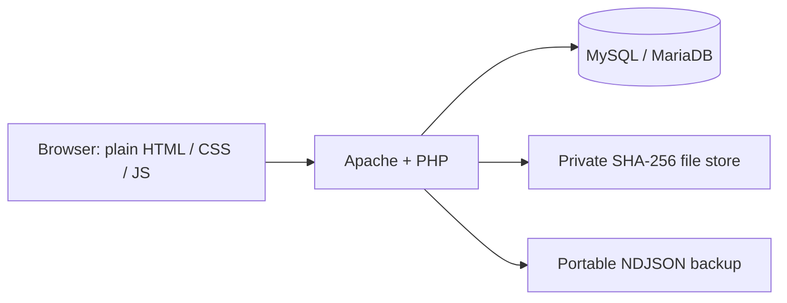

# Timefold ✳

**A personal archive you can travel through.**

Keep a Polaroid scan, a Linux discovery, an old game save, or a fragment of the
web. Turn the year dial to watch your collection unfold. Switch to the
constellation to see which fragments share a thread. Ask **Surprise me** to
find a connection across distant years.

Built for the independent spirit of [CoolCode.ca](https://coolcode.ca/): small
Linux tools, personal archives, home labs, and software you can understand and
change. The included examples are fictional, not recovered personal memories.

PHP + Apache + MySQL/MariaDB. Plain JavaScript and CSS. **No Composer, npm,
framework, CDN, API key, telemetry, or external service.** SQLite is an optional
shortcut for trying the same application without a database server.

Install Timefold locally or on your Apache server. GitHub Pages hosts the
CoolCode.ca catalogue; the archive needs PHP and a database to run.



<details>
<summary>See the constellation</summary>



</details>

## Start in a few minutes

With Docker Engine and its Compose plugin installed:

```sh
git clone https://github.com/jsdyer/jsdyer.github.io.git
cd jsdyer.github.io/tools/timefold
cp .env.example .env
```

Open `.env` in a text editor and fill both password values with your
own distinct passwords (at least 12 characters for the owner password). Then:

```sh
docker compose up -d --build
```

Open **http://localhost:8080** and enter the owner password you put in `.env`.
The first launch includes fictional examples. See `docker compose logs app`
if the page is still starting. The database and original attachments persist
in named volumes across rebuilds and restarts.

Set `TIMEFOLD_SEED_DEMO=0` in `.env` **before the first launch** to start empty.
Changing this setting later does not delete anything. `docker compose down`
stops the app and preserves data. Keep the volumes unless you intend to erase
the archive; `down -v` deletes them.

### Try it without Docker or MySQL

Requires PHP 8.2+ with PDO SQLite and Fileinfo (on Debian/Ubuntu:
`sudo apt install php-cli php-sqlite3`). From the repository directory:

```sh
php bin/timefold.php init --sqlite --demo
php -S 127.0.0.1:8000 -t public
```

Open **http://localhost:8000** and use the generated password printed by `init`.
Leave off `--demo` for an empty archive. Initialization is idempotent; it does
not reset an existing archive. The PHP development server is for local use.

Or choose **Code → Codespaces → Create codespace on main** on GitHub. The
included dev container sets up the same SQLite demo and forwards port 8000
privately. Its terminal shows the generated password. GitHub's Codespaces
usage allowance applies to this optional path.

## Take your first trip

1. Move **Turn back the clock** to an earlier year. Only capsules dated up to
   that year remain; this is a date filter, not a history of past edits.
2. Open **Constellation**. Shared tags create the links. Select a capsule to
   read it, and use the light table whenever you prefer a list of cards.
3. Try **Surprise me**. It chooses related capsules separated in time and tells
   you which tag connects them. There is no AI inference or external request.
4. Select **Add a capsule**. Set the original date, write a note, add tags such
   as `linux, firsts`, and optionally attach a file. Dates must be exact; when
   only the year is known, choose a date and explain the uncertainty in the note.
5. Search, filter by a thread or kind, or print a contact sheet. Print uses
   the current light-table filters.

JPEG, PNG, and WebP receive image previews. Any other file, including a save
game or WARC fragment, is kept as a download. Attachments are limited to
8 MiB each. Identical bytes share a SHA-256 storage object, even when separate
capsules tell different stories about the same file.

The constellation shows at most 120 filtered capsules to keep it readable.
The light table and export retain the full collection. On a large collection,
use the year, kind, tag, or text filters to explore a smaller constellation.

## Keep an independent backup

Choose **Export** to download a `.timefold.ndjson` file containing the notes,
tags, dates, and original attachment bytes. **Import** merges a backup into
the current archive, skipping capsule IDs that are already present. It never
overwrites an edited capsule. Import into a fresh archive to recover an exact
exported collection.

These are readable, unencrypted files: keep them privately. Web import accepts
up to 64 MiB per backup. CLI export/import streams larger collections without
that whole-file limit; the 8 MiB attachment limit still applies:

```sh
php bin/timefold.php export /path/to/my-archive.timefold.ndjson
php bin/timefold.php import /path/to/my-archive.timefold.ndjson
php bin/timefold.php verify
```

With Docker, use the same commands through `docker compose exec app php` and
copy files with `docker compose cp`. For example:

```sh
docker compose exec app php bin/timefold.php export /tmp/archive.timefold.ndjson
docker compose cp app:/tmp/archive.timefold.ndjson ./archive.timefold.ndjson
```

Deleting a capsule removes its record. Stored attachment bytes are retained
so concurrent readers and other capsules remain safe. Export includes only
attachments referenced by current capsules. Removing unused stored bytes is
a manual maintenance task in this version; there is no automatic garbage
collector.

## Run on your own LAMP server

Requires PHP 8.2+, PDO MySQL, Fileinfo, Apache, and MySQL 8 or MariaDB 10.6+.
No Apache rewrite module or `.htaccess` is needed. See
[the native LAMP walkthrough](docs/lamp.md) for database creation, file
permissions, and a localhost Apache virtual host.

Only `public/` is web-accessible. Use a unique password and HTTPS when you
put the app behind your reverse proxy. The default Docker port is bound to
localhost. This is a single-owner archive, not a multi-user hosting service.

## Change it yourself

| Change | Start here |
| --- | --- |
| Colors, spacing, typography, print layout | `public/assets/timefold.css` |
| Date dial, card layout, constellation, connection selection | `public/assets/timefold.js` |
| Labels, navigation, forms | `public/index.html` |
| Validation, archive storage, portable backups | `app/` |
| Login, CSRF checks, HTTP actions | `public/api.php` |
| Setup, backup, verification, password reset | `bin/timefold.php` |

Try changing the orange accent, adding a tag to two capsules from different
years, or changing how **Surprise me** ranks pairs. Your edits appear on
refresh in the native installation; rebuild with `docker compose up -d --build`
for Docker. There is no generated asset bundle to reverse-engineer.

To change the archive's name, set `TIMEFOLD_ARCHIVE_NAME` in `.env` for Docker
or edit `archive_name` in the native `config.local.php`. For a native password
reset, run `php bin/timefold.php password`; add `--password-stdin` to supply
your own. For Docker, change `TIMEFOLD_PASSWORD` in `.env` and recreate the app
with `docker compose up -d`. Password changes revoke existing authenticated
sessions on their next request.



## Explore the GitHub workshop

Open [the GitHub guide](docs/github-guide.md) for a hands-on tour of **Actions,
Codespaces, Releases, issue forms, Dependabot, and Mermaid diagrams**.
Use a branch to experiment and open a pull request to compare your changes.
Timefold lives in `tools/timefold` inside the CoolCode.ca repository.

Run the checks locally with PHP and Python 3 (both test suites use only their
standard libraries):

```sh
php tests/run.php
python3 tests/http_smoke.py
```

See [CONTRIBUTING.md](CONTRIBUTING.md) and [SECURITY.md](SECURITY.md).
Released under the [MIT license](LICENSE), so you can modify and redistribute it.
